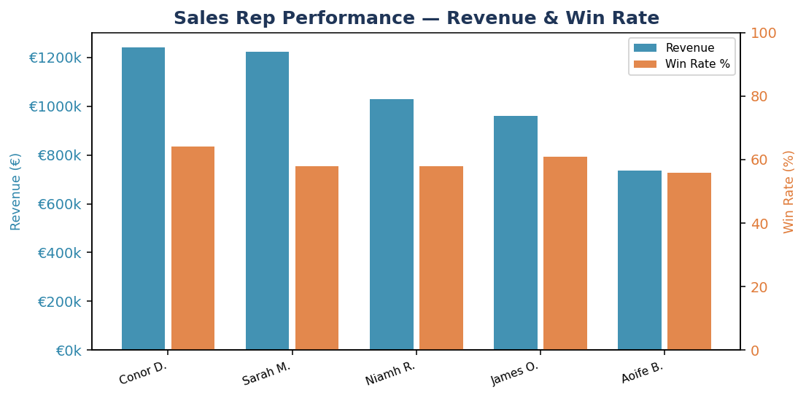

# Sales & CRM Analytics Dashboard

A Python data analytics project that simulates a real-world CRM dataset and produces a fully-formatted Excel dashboard and a set of matplotlib charts — built to demonstrate skills relevant to both **admin/coordinator** and **data analyst** roles.



---

## What It Does

- **Generates** realistic synthetic CRM data: 120 customers, 800 sales transactions across 5 reps, 6 products, 5 Irish regions, and 3 customer segments (SME, Enterprise, Startup)
- **Analyses** key sales KPIs: monthly revenue trend, win rates, segment performance, rep leaderboard, product breakdown, top customers
- **Outputs** a multi-sheet formatted Excel dashboard (`sales_dashboard.xlsx`) with colour-coded tables and summary cards
- **Exports** 5 matplotlib charts as publication-quality PNGs

---

## Skills Demonstrated

| Skill | Where |
|---|---|
| Data generation & structuring | `generate_data.py` — Pandas, NumPy, datetime |
| KPI analysis & aggregation | `analyse.py` — groupby, merge, pct_change |
| Excel reporting (openpyxl) | Multi-sheet workbook, styled headers, number formats, merged cells |
| Data visualisation | 5 Matplotlib charts — line, bar, horizontal bar, grouped bar, pie |
| Project structure & documentation | Modular scripts, clear README |

---

## How to Run

```bash
pip install -r requirements.txt

# Step 1 — generate the data
python generate_data.py

# Step 2 — run analysis and build dashboard
python analyse.py
```

---

## Sample KPIs Produced

- Total revenue across all won deals
- Monthly revenue trend with month-on-month growth %
- Win rate per sales rep
- Average deal size by segment
- Top 10 customers by revenue
- Revenue split by product, region, and customer segment

---

## Technologies

Python · Pandas · NumPy · Matplotlib · openpyxl
